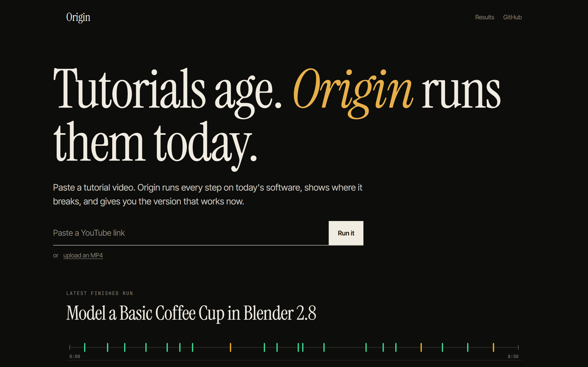
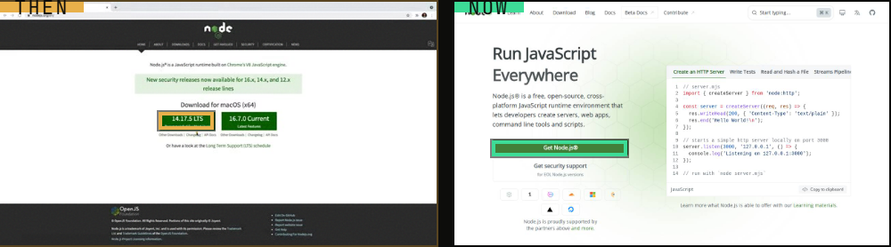
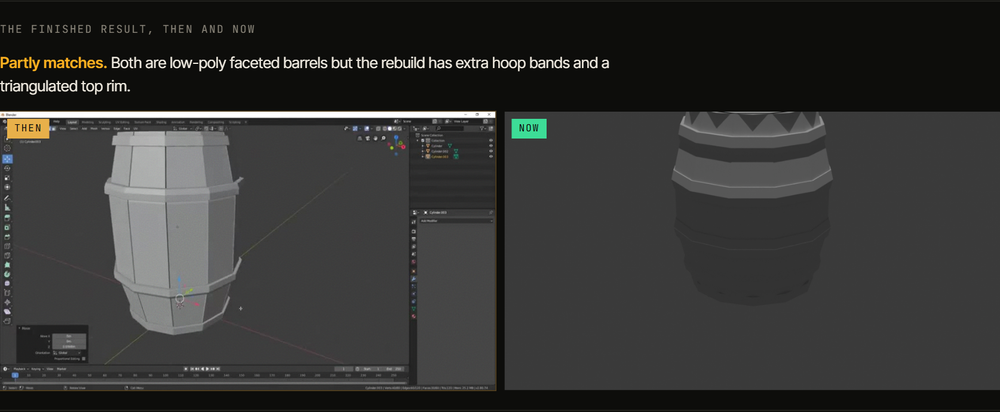
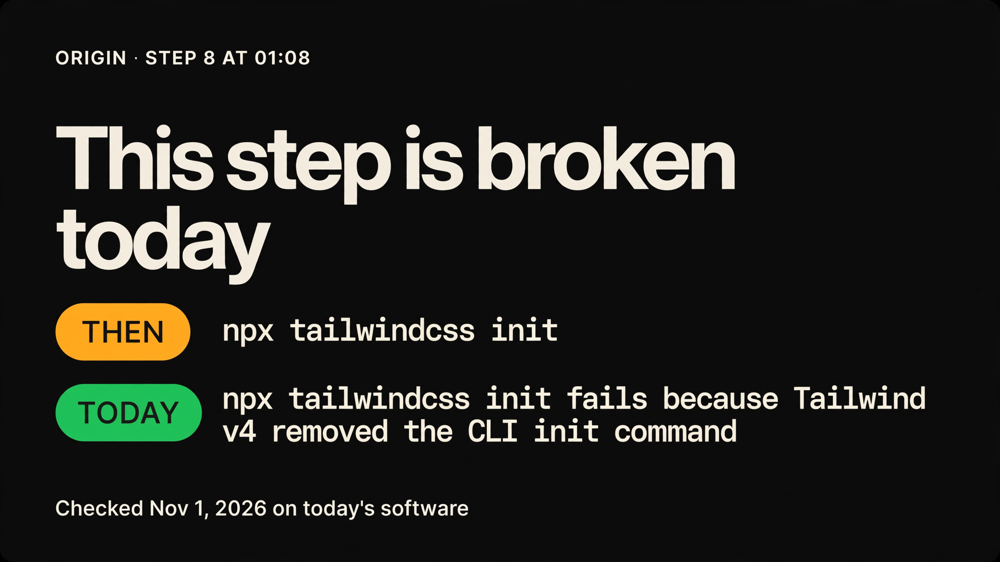
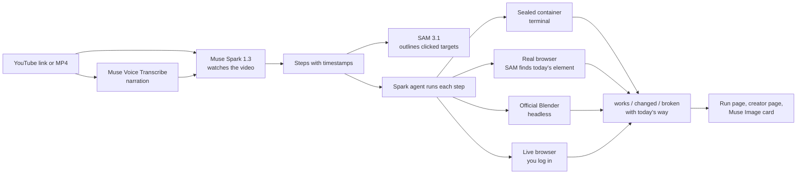

# Origin

**Tutorials age. Origin runs them today.**

Paste a software tutorial video. Origin watches it, runs every step on today's software, shows you where it breaks, and gives you the version that works now.

**Live:** https://origin-two-zeta.vercel.app · **Every run, misses included:** https://origin-two-zeta.vercel.app/results



Built for the Meta Global AI Developer Hackathon, Indie Developer track, Push the Frontier.

---

## The problem

People learn software from video, and software changes every few months. A tutorial from last year breaks at step 4, and the learner has no way to tell which step is wrong or what replaced it.

Worse, many old steps still print **Success** while teaching something retired. Run `npx create-react-app` today and it says "create-react-app is deprecated", lists seven deprecated packages, then reports success. A learner never notices.

## What Origin does

1. **Watches the video.** Muse Spark 1.3 reads the whole tutorial, frames and narration, and writes down every step with its timestamp. Muse Voice Transcribe catches steps that are only spoken ("you need at least Node 14").
2. **Points at what was clicked.** SAM 3.1 outlines the exact button or menu in the old video, then finds the same thing on today's screen.
3. **Runs every step for real.** Terminal steps run in a sealed container. Website steps run in a real browser. Blender steps run in the newest official Blender. Steps that need your account hand you a live browser to log in yourself.
4. **Grades and repairs.** Each step is marked works, changed (runs but is deprecated or no longer the way) or broken. A fix is kept only if Origin actually ran it and it passed.

### Then and now

The old frame with what the narrator clicked, beside today's page with the same thing found again.



### Blender: the finished result, then and now

Origin rebuilds the model in today's Blender, renders it, and Muse Spark says how close it came. It says "partly" when it is partly.



### For creators

A page per video: where it breaks, a comment to pin with the fix and a link to the proof, and a card drawn by Muse Image.



## Judge fast path (five minutes, no keys)

1. Open https://origin-two-zeta.vercel.app/results and open any finished run.
2. Click a tick on the tape at the top: the video jumps to that moment and the step opens.
3. Open a changed step: read the reason, the command that ran, and **Today's way**. The terminal on the right is the real output.
4. Open **For the creator** on a run with changed steps.
5. Try your own: paste a YouTube link of a short coding tutorial, or upload an MP4 (under 50 MB). A run takes 6 to 15 minutes and streams live.

## Meta models, each with a real job

| Model | What it does in Origin |
|---|---|
| **Muse Spark 1.3** | Watches the whole video and writes the steps. Then runs every step as an agent with tools (terminal, browser, Blender), reads the output, grades it, and finds today's way when a step is outdated. Compares the finished Blender model with the video's. |
| **SAM 3.1** | Outlines the clicked element in the old video, and finds the same element on today's live page so Origin can click it. |
| **Muse Voice Transcribe** | Turns narration into text so spoken only steps and version requirements are not missed. |
| **Muse Spark Open** (open weights, on Baseten) | When SAM finds several look alike elements, it looks at them outlined in colors and picks the one the step means. |
| **Muse Image** | Draws a step card a creator can pin under their video, with the exact command text. |

## How it works



Each run is one GitHub Actions job: a fresh Linux machine, a Docker container for the tutorial's commands (no secrets inside it), Chromium for web steps, and the newest official Blender downloaded from blender.org. Events stream to Supabase, and the run page shows them live.

## What is real

| Part | Status |
|---|---|
| Video understanding, step extraction | Live, Muse Spark 1.3 on the Meta Model API |
| Terminal, browser and Blender runners | Live, every run is a real execution |
| Then and now outlines | Live, SAM 3.1 on the old frame and today's screenshot |
| Live login hand over | Live. Only the person who started a run can control it; what they type is applied and deleted, never stored or logged |
| Stops before publish, pay, delete, send | Live, those steps are marked gated |
| Results and misses | Public: [results page](https://origin-two-zeta.vercel.app/results), [misses and fixes](docs/benchmark/MISSES.md) |

## Safety

- Tutorial commands run in a container that has none of Origin's keys.
- Origin never presses publish, pay, delete or send. Those steps stop for you.
- Account steps use a live browser you log into yourself. Typed input goes through a private table and is deleted as soon as it is applied.

## Run it yourself

```bash
npm ci
npm run build -w @origin/core && npm run build -w @origin/runner
# .env at the repo root: META_API_KEY, SUPABASE_URL, SUPABASE_SECRET_KEY, BASETEN_API_KEY
# Apply supabase/schema.sql and supabase/002_live_browser.sql in the Supabase SQL editor.
node packages/runner/dist/main.js --video path/to/tutorial.mp4 --sandbox local
npm run dev -w web
```

Repo layout: `packages/core` (step parsing, grading, SAM parsing, the publish and pay gate, with tests), `packages/runner` (extraction, agent, runners, ingest), `apps/web` (the site), `docs/` (PRD, plan, spikes, benchmark).

## License

MIT
